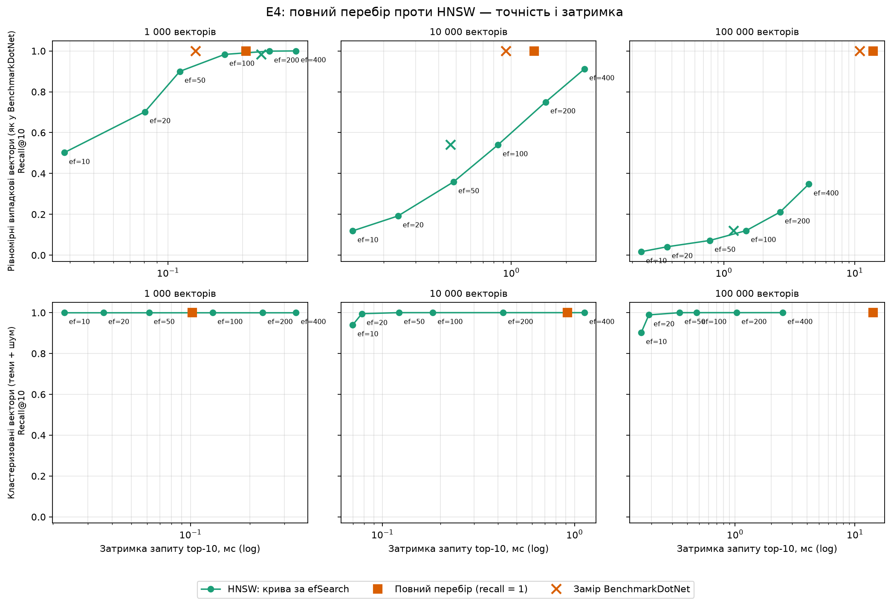

# Результати дослідження

Розділ звіту: відповіді на дослідницькі питання RQ1–RQ4 і результати експериментів E1–E4.

> **Стан.** Готовий лише **E4** (на синтетичних векторах, див. [e4-hnsw.md](e4-hnsw.md)). Підрозділи **E1–E3** — заготовки:
> вони чекають на корпус і розмітку (R-01, R-02), і чисел у них немає навмисно. Місця, які треба заповнити, позначено **TODO**.

## Зміст

1. [Дослідницькі питання і гіпотеза](#1-дослідницькі-питання-і-гіпотеза)
2. [Датасет і метрики](#2-датасет-і-метрики)
3. [E1 — метод пошуку](#3-e1--метод-пошуку-rq1)
4. [E2 — embedding-модель](#4-e2--embedding-модель-rq2)
5. [E3 — нарізка на фрагменти](#5-e3--нарізка-на-фрагменти-rq3)
6. [E4 — індекс: повний перебір проти HNSW](#6-e4--індекс-повний-перебір-проти-hnsw-rq4)
7. [Відповіді на RQ1–RQ4](#7-відповіді-на-rq1rq4)
8. [Загрози валідності](#8-загрози-валідності)
9. [Як відтворити](#9-як-відтворити)

## 1. Дослідницькі питання і гіпотеза

| | Питання |
|---|---|
| **RQ1** · Пошук | Наскільки semantic і hybrid кращі за BM25 на реальних особистих нотатках — і на яких типах запитів? |
| **RQ2** · Моделі | Яка embedding-модель дає найкращий баланс якості й швидкості на CPU для змішаних UA/EN текстів? |
| **RQ3** · Chunking | Як розмір фрагмента, перекриття і стратегія нарізки впливають на якість? |
| **RQ4** · Індекс | З якого обсягу бази HNSW вигідніший за точний перебір і скільки точності ми втрачаємо? |

**Гіпотеза:** hybrid виграє в середньому; semantic — на перефразованих і міжмовних запитах; BM25 — на точних термінах.

Кожен експеримент змінює **одну** змінну, решта фіксована. Експерименти E1–E3 запускає `localmind eval`, E4 — проєкт
`benchmarks/LocalMind.Benchmarks`.

## 2. Датасет і метрики

**Датасет** — тека з `corpus/`, `queries.jsonl` і `qrels.jsonl`; формат і правила розмітки — в
[eval/datasets/README.md](../../eval/datasets/README.md). Розмітка йде на рівні **документів**, бо межі фрагментів залежать
від налаштувань нарізки (E3), а ідентифікатори фрагментів змінюються при кожній індексації ([DR-021](../decisions.md)).
Типи запитів: `exact` (точні слова й терміни), `paraphrase` (те саме іншими словами), `crossLingual` (запит однією мовою,
документ іншою).

- **Корпус** (R-01, [issue #182](https://github.com/ShyriaievMykola/LocalMind/issues/182)): відкритий багатомовний корпус, а не особисті нотатки: тисячі
  документів (uk, en, de, pl, fr, es, it; російської немає) з Вікіпедії, Wikivoyage, Project Gutenberg і Stack Exchange у форматах md/txt
  з частиною docx/pdf; ліцензії й джерела в `manifest.jsonl`, тексти в Git не кладуться. TODO: фінальні цифри після збірки корпусу (кількість документів за
  мовами, джерелами й темами, обсяг у фрагментах). Повний корпус налічує ~6,4 тис. документів (~90 тис. фрагментів); для E1–E3 розмітка й прогони йдуть на
  підкорпусі `open-eval` (≈ 800–1000 документів), бо повна індексація триває 2–2,5 години; E4 його не потребує.
- **Запити й розмітка** (R-02): розмітку роблять **агенти за письмовим протоколом**, команда перевіряє вибірку. Інструменти й протокол —
  [eval/datasets/open/labeling/README.md](../../eval/datasets/open/labeling/README.md) (з PR #189):
  1. запити пишуться **від документа**, а не від видачі пошуку (стратифікована вибірка документів за мовами, джерелами й темами): ~90 запитів, по 30
     exact, paraphrase (без жодного значущого слова документа, це перевіряє скрипт) і crossLingual (відповідники статті іншими мовами йдуть у qrels автоматично);
  2. **пулінг:** для кожного запиту top-k з keyword, semantic і hybrid об'єднуються, додається документ-джерело;
  3. кожного кандидата оцінюють **0–3** за текстом фрагмента й заголовком за письмовою інструкцією (нулі не потрапляють у qrels, але зберігаються в `judgments.jsonl`);
  4. **вибіркова перевірка людьми:** команда оцінює 30 пар самостійно, а ми рахуємо збіг з оцінкою агента.
  TODO: дані після R-02: кількість запитів за типами й мовами, розподіл оцінок, частка збігу з людьми.
- **Демонстраційний набір** `eval/datasets/demo` (6 документів, 8 запитів) призначений для перевірки конвеєра, а не для висновків.

**Метрики якості** (рахуються за документами, результат пошуку згортається до першої появи документа): Recall@k, MRR,
nDCG@k з лінійним виграшем; усі за типами запитів окремо й разом. **Продуктивність:** затримка p50/p95, час індексації,
розмір бази, пікова пам'ять процесу (обмеження пам'яті — у [eval/experiments/README.md](../../eval/experiments/README.md)).

## 3. E1 — метод пошуку (RQ1)

**Мета.** Порівняти BM25 (keyword), semantic і hybrid (RRF) і з'ясувати, на яких типах запитів кожен виграє.

**Методика.** Датасет з розділу 2; одна модель (`multilingual-e5-small`) і одна нарізка (за замовчуванням: `fixedSize`, 256 токенів,
перекриття 15 %); змінюється лише режим пошуку; `k = 10`. Результати: Recall@10, MRR, nDCG@10 і p50/p95 за типами запитів.

**Відтворення** (з кореня репозиторію; для semantic і hybrid модель має бути завантажена: `scripts/download-models`):

```bash
dotnet run --project src/LocalMind.Cli -c Release -- eval --dataset <тека датасету> --mode keyword semantic hybrid --k 10
python eval/plots/plot_eval.py eval/results
```

**Таблиця.** TODO: дані після R-01/R-02 — Recall@10, MRR, nDCG@10, p50 і p95 за режимом і типом запитів (формат: Markdown-файл,
який пише `eval` у `eval/results/`).

| Режим | Тип запитів | Запитів | Recall@10 | MRR | nDCG@10 | p50, мс | p95, мс |
|---|---|---:|---:|---:|---:|---:|---:|
| keyword | all | TODO | TODO | TODO | TODO | TODO | TODO |
| semantic | all | TODO | TODO | TODO | TODO | TODO | TODO |
| hybrid | all | TODO | TODO | TODO | TODO | TODO | TODO |

*(рядки за типами `exact`, `paraphrase`, `crossLingual` додати з Markdown-звіту.)*

**Графіки.** TODO: `eval/plots/out/<датасет>/quality_vs_latency` і `by_query_type` (див. [eval/plots/README.md](../../eval/plots/README.md)).

**Висновок.** TODO: чи підтвердилась гіпотеза (hybrid виграє в середньому; semantic — на перефразованих і міжмовних;
BM25 — на точних термінах), з посиланням на таблицю.

## 4. E2 — embedding-модель (RQ2)

**Мета.** Знайти модель з найкращим балансом якості й швидкості на CPU для змішаних UA/EN текстів.

**Методика.** Датасет і нарізка однакові для всіх; змінюється лише модель із каталогу ([DR-024](../decisions.md)):
`multilingual-e5-small` (базова), `multilingual-e5-base`, `paraphrase-multilingual-MiniLM-L12-v2`,
`paraphrase-multilingual-mpnet-base-v2`. Розмір фрагмента 120 токенів: у `paraphrase-*` ліміт 128. Режими semantic і hybrid
(для e5-small ще keyword як нижня межа). Додатково заміряються час індексації, розмір бази й пам'ять. `bge-m3` у каталог не входить (причини — [DR-024](../decisions.md)); англомовний контроль `all-MiniLM-L6-v2` теж ні:
його токенізатор не XLM-R, а `ModelTokenizer` підтримує лише його.

**Відтворення** (моделі: `scripts/download-models all`, ~3,2 ГБ):

```bash
dotnet run --project src/LocalMind.Cli -c Release -- eval --dataset <тека датасету> --config eval/experiments/e2.json
python eval/plots/plot_eval.py eval/results
```

Кожна модель індексує корпус у власній тимчасовій базі; для чесного порівняння пам'яті запускайте моделі окремими
конфігами (пояснення — [eval/experiments/README.md](../../eval/experiments/README.md)).

**Таблиця.** TODO: дані після R-01/R-02.

| Модель | Розмірність | Режим | Recall@10 | nDCG@10 | p50, мс | Час індексації, с | Розмір бази, МБ |
|---|---:|---|---:|---:|---:|---:|---:|
| multilingual-e5-small | 384 | hybrid | TODO | TODO | TODO | TODO | TODO |
| multilingual-e5-base | 768 | hybrid | TODO | TODO | TODO | TODO | TODO |
| paraphrase-multilingual-MiniLM-L12-v2 | 384 | hybrid | TODO | TODO | TODO | TODO | TODO |
| paraphrase-multilingual-mpnet-base-v2 | 768 | hybrid | TODO | TODO | TODO | TODO | TODO |

**Графік.** TODO: якість проти затримки по моделях (`quality_vs_latency`).

**Висновок.** TODO: яка модель дає найкращий баланс, чи виправдана вдвічі більша розмірність, як моделі поводяться на `crossLingual`.

## 5. E3 — нарізка на фрагменти (RQ3)

**Мета.** З'ясувати, як розмір фрагмента, перекриття й стратегія нарізки впливають на якість.

**Методика.** Датасет і модель (`multilingual-e5-small`) фіксовані; змінюється нарізка: розмір 128/256/512 токенів × перекриття 0/15 %
(6 комбінацій; стратегія `paragraph` у конфіг не входить: кожна додаткова комбінація — ще одна повна індексація). Режими semantic і hybrid. Розмітка за документами, тож метрики порівнянні
між нарізками.

**Відтворення:**

```bash
dotnet run --project src/LocalMind.Cli -c Release -- eval --dataset <тека датасету> --config eval/experiments/e3.json
python eval/plots/plot_eval.py eval/results
```

Для кожної комбінації корпус індексується заново, тож прогін коштує стільки індексацій, скільки комбінацій у конфігу
([DR-025](../decisions.md)); для E1–E3 береться підкорпус `open-eval` (≈ 800–1000 документів), одна індексація якого триває ≈ 15–20 хв, а на повному корпусі (~6,4 тис. документів) — 2–2,5 години.

**Таблиця.** TODO: дані після R-01/R-02.

| Нарізка | Фрагментів | Режим | Recall@10 | nDCG@10 | p50, мс | Розмір бази, МБ |
|---|---:|---|---:|---:|---:|---:|
| fixedSize 128/0 % | TODO | hybrid | TODO | TODO | TODO | TODO |
| fixedSize 128/15 % | TODO | hybrid | TODO | TODO | TODO | TODO |
| fixedSize 256/0 % | TODO | hybrid | TODO | TODO | TODO | TODO |
| fixedSize 256/15 % | TODO | hybrid | TODO | TODO | TODO | TODO |
| fixedSize 512/0 % | TODO | hybrid | TODO | TODO | TODO | TODO |
| fixedSize 512/15 % | TODO | hybrid | TODO | TODO | TODO | TODO |

**Графік.** TODO: nDCG@10 проти розміру фрагмента (за колонками `chunk_size_tokens`, `overlap_percent` у CSV).
Скрипт `plot_eval.py` будує графіки за прогонами, окремий графік для E3 може знадобитися.

**Висновок.** TODO: який розмір і перекриття оптимальні, ціна в розмірі бази.

## 6. E4 — індекс: повний перебір проти HNSW (RQ4)

**Мета.** З'ясувати, з якого обсягу бази HNSW вигідніший за повний перебір і скільки точності при цьому втрачається.

**Методика.** Один набір векторів розмірності 384 на кожен розмір 1k / 10k / 100k; два набори даних — рівномірний шум (найважчий
випадок) і кластеризовані вектори; параметри HNSW за замовчуванням (M = 16, efConstruction = 200, efSearch = 100) плюс крива
recall за `efSearch`. Метрики: recall@10 проти повного перебору, затримка запиту, час побудови. Повний опис, залізо й умови —
в [e4-hnsw.md](e4-hnsw.md).

**Відтворення** (повний прогін ≈ 20 хвилин):

```bash
dotnet run -c Release --project benchmarks/LocalMind.Benchmarks -- --filter "*SearchBenchmarks*" --job short --artifacts <тека>
dotnet run -c Release --project benchmarks/LocalMind.Benchmarks -- --recall --out <тека>/e4-recall.csv
python eval/plots/plot_e4.py --bdn <тека>/results/LocalMind.Benchmarks.SearchBenchmarks-report.csv --recall <тека>/e4-recall.csv --out <тека>/plots
```

**Результати** (стисло; повні таблиці — в [e4-hnsw.md](e4-hnsw.md)):

- **Кластеризовані вектори (набір E4):** при `efSearch = 100` recall@10 = 1,000 на 1k, 10k і 100k; HNSW швидший за повний перебір у ≈ 5 разів
  на 10k і ≈ 30 разів на 100k (478 мкс проти 14,2 мс), на 1k вигоди немає. **Застереження:** набір E4 «легкий». На іншому кластеризованому наборі ([DR-023](../decisions.md))
  recall@10 на 10k при `efSearch = 100` лише 0,87 (0,95 при 200), тож висновок «HNSW вигідний уже з 10k» стосується лише цього легкого набору.
- **Рівномірний шум:** recall@10 при `efSearch = 100` падає з 0,98 (1k) до 0,54 (10k) і 0,12 (100k); щоб дістати ≈ 0,9 на 10k, треба
  `efSearch = 400`, і тоді HNSW повільніший за повний перебір (цифри затримок — у [e4-hnsw.md](e4-hnsw.md), висновок 1, там же таблиця за `efSearch`).



**Висновок.** Вигода HNSW гарантована з ≈ 100k фрагментів і залежить від даних; на десятках тисяч фрагментів лишається
повний перебір (≈ 1 мс на запит). Значення `efSearch` на великих індексах треба підбирати за recall на власних даних
([DR-023](../decisions.md)). **Обмеження:** дані синтетичні, один прогін на одному ноутбуці; повторити на ембедингах справжнього корпусу
(див. розділ 8).

## 7. Відповіді на RQ1–RQ4

| | Відповідь | Стан |
|---|---|---|
| **RQ1** | TODO: після E1 | чекає на R-01/R-02 |
| **RQ2** | TODO: після E2 | чекає на R-01/R-02 |
| **RQ3** | TODO: після E3 | чекає на R-01/R-02 |
| **RQ4** | HNSW вигідніший з ≈ 100k фрагментів (на «легкому» кластеризованому наборі E4 уже з 10k, але на іншому кластеризованому наборі recall@10 на 10k при `efSearch = 100` лише 0,87, див. розділ 6); втрата точності визначається `efSearch` і структурою даних: на кластеризованих recall ≈ 1,0, на рівномірному шумі різко падає із зростанням бази. | попередньо: на синтетиці, потребує повтору на реальному корпусі |

## 8. Загрози валідності

- **Синтетичні дані в E4.** Вектори згенеровано, а не отримано від моделі з реальних текстів: «рівномірний шум» — найгірший випадок для
  HNSW, «кластеризовані» — нетипово легкий. Висновок про `efSearch` для справжніх ембедингів треба підтвердити на реальному корпусі.
- **Один прогін.** Затримки між запусками відрізняються на десятки відсотків; BenchmarkDotNet запускався в режимі `--job short`
  (3 ітерації), тож похибка велика. Висновки спираються на порядок величин і на recall.
- **Одне залізо.** Усі заміри — на одному ноутбуці (AMD Ryzen 7 7735HS, Windows 11), без перевірки на інших ОС і процесорах,
  зокрема без AVX512 і на ARM; абсолютні значення затримок і часу побудови не переносяться.
- **Розмір корпусу й запитів.** Запитів близько 90 (по 30 на тип): оцінки метрик мають похибку, різниці в частки відсотка статистично не значущі, а на окремих
  типах і мовах вибірка ще менша. Корпус налічує тисячі документів, але це все одно далеко від 100k фрагментів з E4, тож висновки E1–E3 не
  екстраполюються на великі бібліотеки.
- **Відкритий корпус замість особистих нотаток.** RQ1 питає про *особисті* нотатки, а корпус складається з енциклопедичних, художніх і Q&A текстів:
  інша структура (немає чернеток, скорочень, змішаних мов в одному документі), інші типові запити. Висновки E1–E3 переносяться на особисті нотатки лише з обережністю.
- **Генерована розмітка.** Запити й оцінки 0–3 створюють агенти (мовні моделі), а не люди; їхні упередження й помилки потрапляють у qrels. Захист: протокол
  (запити від документа, не від видачі; paraphrase без спільних слів; пул з трьох режимів, щоб не підігравати одному з них) і вибіркова перевірка людьми з підрахунком
  збігу (TODO: дані після R-02). Розмітка на рівні документів, тому не показує, чи знайшовся саме потрібний абзац. Моделі, якими користуються агенти, можуть бути
  схожими на embedding-моделі за даними навчання, що теж може спотворювати оцінки semantic-режиму.
- **Пам'ять.** Пікова пам'ять процесу не скидається між комбінаціями в одному запуску ([eval/experiments/README.md](../../eval/experiments/README.md)).
- **Модель і мова.** Моделі каталогу мультимовні; якість для української порівнюється лише між ними, без англомовного контролю
  (його токенізатор не підтримується, див. розділ 4).

## 9. Як відтворити

Налаштування: .NET 10 SDK, `scripts/download-models` (`all` — усі моделі E2) і Python 3.10+ з `eval/plots/requirements.txt` для графіків
([eval/plots/README.md](../../eval/plots/README.md)). Усі команди запускаються з кореня репозиторію. Опис формату конфігів експериментів —
[eval/experiments/README.md](../../eval/experiments/README.md), формату датасету — [eval/datasets/README.md](../../eval/datasets/README.md).
