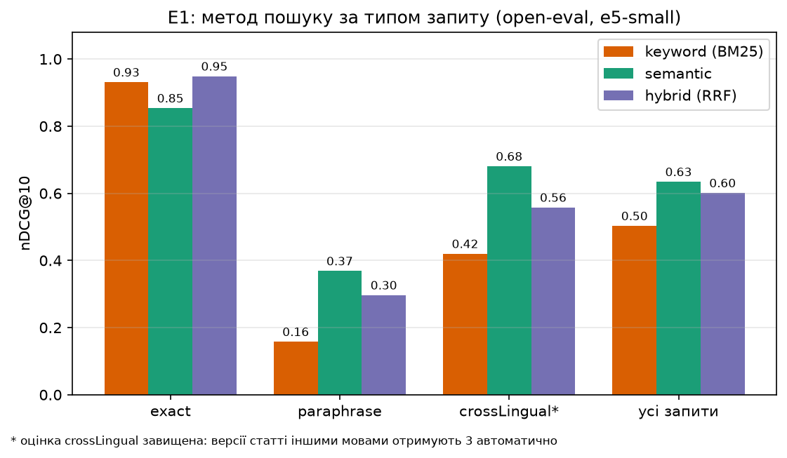
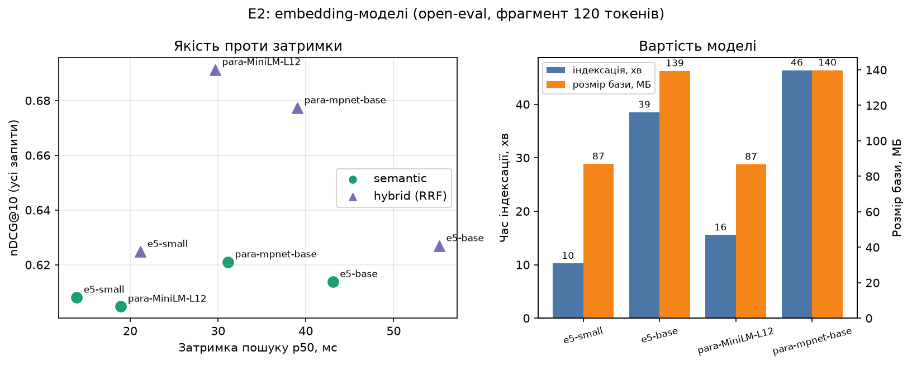
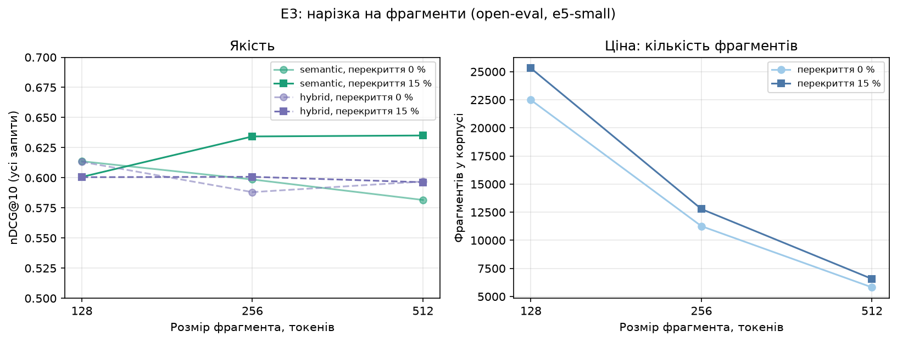

# Результати дослідження

Розділ звіту: відповіді на дослідницькі питання RQ1–RQ4 і результати експериментів E1–E4.

> **Стан.** Є результати **E1–E3 на підкорпусі open-eval** (902 документи, 90 запитів, один прогін) і **E4 на синтетичних векторах** ([e4-hnsw.md](e4-hnsw.md)).
> Висновки попередні: розмітку зроблено агентом без перевірки командою, метрика crossLingual завищена автоматичною розміткою, а різниці менші за ≈ 0,03 nDCG@10 не слід вважати значущими
> (див. розділ 8). Сирі дані й графіки: `data/` і `figures/` у цій теці.

## Зміст

1. [Дослідницькі питання і гіпотеза](#1-дослідницькі-питання-і-гіпотеза)
2. [Датасет і метрики](#2-датасет-і-метрики)
3. [E1 — метод пошуку](#3-e1--метод-пошуку-rq1)
4. [E2 — embedding-модель](#4-e2--embedding-модель-rq2)
5. [E3 — нарізка на фрагменти](#5-e3--нарізка-на-фрагменти-rq3)
6. [E4 — індекс: повний перебір проти HNSW](#6-e4--індекс-повний-перебір-проти-hnsw-rq4)
7. [Відповіді на RQ1–RQ4](#7-відповіді-на-rq1rq4)
8. [Загрози валідності](#8-загрози-валідності)
9. [Як відтворити](#9-як-відтворити)

## 1. Дослідницькі питання і гіпотеза

| | Питання |
|---|---|
| **RQ1** · Пошук | Наскільки semantic і hybrid кращі за BM25 на реальних особистих нотатках — і на яких типах запитів? |
| **RQ2** · Моделі | Яка embedding-модель дає найкращий баланс якості й швидкості на CPU для змішаних UA/EN текстів? |
| **RQ3** · Chunking | Як розмір фрагмента, перекриття і стратегія нарізки впливають на якість? |
| **RQ4** · Індекс | З якого обсягу бази HNSW вигідніший за точний перебір і скільки точності ми втрачаємо? |

**Гіпотеза:** hybrid виграє в середньому; semantic — на перефразованих і міжмовних запитах; BM25 — на точних термінах.

Кожен експеримент змінює **одну** змінну, решта фіксована. Експерименти E1–E3 запускає `localmind eval`, E4 — проєкт
`benchmarks/LocalMind.Benchmarks`.

## 2. Датасет і метрики

**Датасет** — тека з `corpus/`, `queries.jsonl` і `qrels.jsonl`; формат і правила розмітки — в
[eval/datasets/README.md](../../eval/datasets/README.md). Розмітка йде на рівні **документів**, бо межі фрагментів залежать
від налаштувань нарізки (E3), а ідентифікатори фрагментів змінюються при кожній індексації ([DR-021](../decisions.md)).
Типи запитів: `exact` (точні слова й терміни), `paraphrase` (те саме іншими словами), `crossLingual` (запит однією мовою,
документ іншою).

- **Корпус** (R-01, [issue #182](https://github.com/ShyriaievMykola/LocalMind/issues/182)): відкритий багатомовний корпус, а не особисті нотатки: тисячі
  документів (uk, en, de, pl, fr, es, it; російської немає) з Вікіпедії, Wikivoyage, Project Gutenberg і Stack Exchange у форматах md/txt
  з частиною docx/pdf; ліцензії й джерела в `manifest.jsonl`, тексти в Git не кладуться. Повний корпус налічує ~6,4 тис. документів (~90 тис. фрагментів); для E1–E3 розмітка й прогони йдуть на
  підкорпусі `open-eval` (≈ 800–1000 документів), бо повна індексація триває 2–2,5 години; E4 його не потребує.
- **Запити й розмітка** (R-02): розмітку роблять **агенти за письмовим протоколом**, команда перевіряє вибірку. Інструменти й протокол —
  [eval/datasets/open/labeling/README.md](../../eval/datasets/open/labeling/README.md) (з PR #189):
  1. запити пишуться **від документа**, а не від видачі пошуку (стратифікована вибірка документів за мовами, джерелами й темами): ~90 запитів, по 30
     exact, paraphrase (без жодного значущого слова документа, це перевіряє скрипт) і crossLingual (відповідники статті іншими мовами йдуть у qrels автоматично);
  2. **пулінг:** для кожного запиту top-k з keyword, semantic і hybrid об'єднуються, додається документ-джерело;
  3. кожного кандидата оцінюють **0–3** за текстом фрагмента й заголовком за письмовою інструкцією (нулі не потрапляють у qrels, але зберігаються в `judgments.jsonl`);
  4. **вибіркова перевірка людьми:** команда оцінює 30 пар самостійно, а ми рахуємо збіг з оцінкою агента.
  **Результат (open-eval, [PR #197](https://github.com/ShyriaievMykola/LocalMind/pull/197)):** 90 запитів (по 30 exact, paraphrase, crossLingual; мови запитів uk 40, en 38, de/fr/pl по 4), пул top-10 з трьох режимів дав
  680 кандидатів на оцінку (разом із джерелами й перекладами 890); оцінки 0 — 616, 1 — 37, 3 — 27, оцінок 2 немає (за правилом «сумнів → нижча»); у qrels 274 пари (237 з оцінкою 3, з них 210 автоматичні:
  джерело й переклади статті). **TODO: частка збігу з людьми** — після перевірки командою (`sample-for-humans.md`).
- **Демонстраційний набір** `eval/datasets/demo` (6 документів, 8 запитів) призначений для перевірки конвеєра, а не для висновків.

**Метрики якості** (рахуються за документами, результат пошуку згортається до першої появи документа): Recall@k, MRR,
nDCG@k з лінійним виграшем; усі за типами запитів окремо й разом. **Продуктивність:** затримка p50/p95, час індексації,
розмір бази, пікова пам'ять процесу (обмеження пам'яті — у [eval/experiments/README.md](../../eval/experiments/README.md)).

## 3. E1 — метод пошуку (RQ1)

**Мета.** Порівняти BM25 (keyword), semantic і hybrid (RRF) і з'ясувати, на яких типах запитів кожен виграє.

**Методика.** Датасет `open-eval` (розділ 2); одна модель (`multilingual-e5-small`) і одна нарізка (`fixedSize`, 256 токенів,
перекриття 15 %); змінюється лише режим пошуку; `k = 10`. Заміри: Recall@10, MRR, nDCG@10, p50 і p95 часу пошуку.

**Відтворення** (з кореня репозиторію; для semantic і hybrid потрібна модель: `scripts/download-models`):

```bash
dotnet run --project src/LocalMind.Cli -c Release -- eval --dataset <тека open-eval> --mode keyword semantic hybrid --k 10
```

**Результати.** Корпус: 902 документи, 12 782 фрагменти; індексація 21,5 хв, база 56,6 МБ, пікова пам'ять процесу 1494 МБ.
Сирі дані — [data/e1-open-eval.csv](data/e1-open-eval.csv) і [.md](data/e1-open-eval.md).

| Режим | Тип запитів | Recall@10 | MRR | nDCG@10 | p50, мс | p95, мс |
|---|---|---:|---:|---:|---:|---:|
| keyword | усі | 0,520 | 0,719 | 0,503 | 19,2 | 67,2 |
| keyword | exact | 0,906 | 1,000 | 0,931 | 13,9 | 66,7 |
| keyword | paraphrase | 0,317 | 0,157 | 0,158 | 20,4 | 73,0 |
| keyword | crossLingual* | 0,337 | 1,000 | 0,420 | 24,8 | 67,2 |
| semantic | усі | 0,704 | 0,756 | 0,634 | 25,3 | 53,5 |
| semantic | exact | 0,883 | 0,909 | 0,854 | 24,5 | 73,1 |
| semantic | paraphrase | 0,558 | 0,359 | 0,369 | 23,1 | 53,5 |
| semantic | crossLingual* | 0,671 | 1,000 | 0,681 | 30,9 | 45,6 |
| hybrid | усі | 0,666 | 0,757 | 0,601 | 36,5 | 107,7 |
| hybrid | exact | 0,933 | 1,000 | 0,949 | 32,3 | 94,8 |
| hybrid | paraphrase | 0,517 | 0,289 | 0,297 | 40,0 | 114,4 |
| hybrid | crossLingual* | 0,549 | 0,983 | 0,558 | 45,5 | 107,5 |

\* **Метрики crossLingual завищені розміткою.** Версії тієї самої статті іншими мовами за протоколом отримують оцінку 3 автоматично, і їх легко
знайти; тому MRR для crossLingual дорівнює 1,000 майже в усіх режимах і моделях. Цей стовпець показує, що переклад статті знаходиться, а не
наскільки добре система знаходить відповіді іншою мовою; за ним не слід порівнювати режими чи моделі.



**Висновок.**

1. **На точних запитах** найкращі hybrid (nDCG@10 0,949) і keyword (0,931), semantic трохи гірший (0,854): BM25 дійсно сильний на термінах і назвах.
2. **На перефразованих запитах** keyword майже безсилий (0,158), semantic удвічі кращий (0,369), hybrid посередині (0,297): RRF «розбавляє» семантичні
   результати слабкими keyword-збігами. Абсолютні значення невеликі: 30 запитів, суворо без спільних слів з документом.
3. **Гіпотеза підтвердилась частково.** Semantic виграє на перефразованих запитах, BM25/hybrid — на точних. Твердження «hybrid виграє в середньому» **не підтвердилось**:
   за nDCG@10 усереднено semantic (0,634) попереду hybrid (0,601) і keyword (0,503); за MRR вони майже рівні (0,756 і 0,757). Але в E2 при нарізці в 120 токенів hybrid
   перевершує semantic для всіх чотирьох моделей, тож різниця 0,03 між semantic і hybrid — на межі шуму одного прогону.

## 4. E2 — embedding-модель (RQ2)

**Мета.** Знайти модель з найкращим балансом якості й швидкості на CPU для змішаних UA/EN текстів.

**Методика.** Датасет і нарізка однакові для всіх; змінюється лише модель із каталогу ([DR-024](../decisions.md)):
`multilingual-e5-small` (базова), `multilingual-e5-base`, `paraphrase-multilingual-MiniLM-L12-v2`,
`paraphrase-multilingual-mpnet-base-v2`. Розмір фрагмента 120 токенів (у `paraphrase-*` ліміт 128), перекриття 15 %. Режими semantic і hybrid
(для e5-small ще keyword як нижня межа). `bge-m3` у каталог не входить (причини — [DR-024](../decisions.md)); англомовний контроль `all-MiniLM-L6-v2` теж ні:
його токенізатор не XLM-R, а `ModelTokenizer` підтримує лише його.

**Відтворення** (моделі: `scripts/download-models all`, ~3,2 ГБ; прогін триває близько 2 годин):

```bash
dotnet run --project src/LocalMind.Cli -c Release -- eval --dataset <тека open-eval> --config eval/experiments/e2.json
```

**Результати.** Дані — [data/e2-open-eval.csv](data/e2-open-eval.csv). Вартість моделей (усі 902 документи, нарізка 120/15 %):

| Модель | Фрагментів | Індексація, хв | База, МБ | Пікова пам'ять, МБ |
|---|---:|---:|---:|---:|
| multilingual-e5-small | 27031 | 10,2 | 86,9 | 1494 |
| multilingual-e5-base | 27031 | 38,5 | 139,5 | 3161 |
| paraphrase-multilingual-MiniLM-L12-v2 | 26999 | 15,6 | 86,8 | 3161 |
| paraphrase-multilingual-mpnet-base-v2 | 26999 | 46,4 | 139,8 | 3161 |

Пікова пам'ять — це пік усього процесу (нічого не скидається між моделями), тому 3161 МБ у трьох останніх рядків — це пам'ять найважчої моделі (e5-base), а не їхня власна.

Якість (nDCG@10 за типами запитів, Recall@10 і MRR для всіх запитів):

| Модель | Розм. | Режим | nDCG@10 усі | exact | paraphrase | crossLingual* | Recall@10 | MRR | p50, мс |
|---|---:|---|---:|---:|---:|---:|---:|---:|---:|
| multilingual-e5-small | 384 | keyword | 0,492 | 0,924 | 0,124 | 0,427 | 0,488 | 0,705 | 8,6 |
| multilingual-e5-small | 384 | semantic | 0,608 | 0,773 | 0,353 | 0,698 | 0,676 | 0,728 | 13,9 |
| multilingual-e5-small | 384 | hybrid | 0,625 | 0,938 | 0,365 | 0,571 | 0,680 | 0,791 | 21,2 |
| multilingual-e5-base | 768 | semantic | 0,614 | 0,779 | 0,402 | 0,661 | 0,667 | 0,751 | 43,1 |
| multilingual-e5-base | 768 | hybrid | 0,627 | 0,910 | 0,404 | 0,567 | 0,654 | 0,801 | 55,2 |
| paraphrase-multilingual-MiniLM-L12-v2 | 384 | semantic | 0,605 | 0,684 | 0,218 | 0,912 | 0,685 | 0,618 | 18,9 |
| paraphrase-multilingual-MiniLM-L12-v2 | 384 | hybrid | 0,691 | 0,916 | 0,295 | 0,863 | 0,770 | 0,761 | 29,7 |
| paraphrase-multilingual-mpnet-base-v2 | 768 | semantic | 0,621 | 0,650 | 0,353 | 0,860 | 0,718 | 0,636 | 31,1 |
| paraphrase-multilingual-mpnet-base-v2 | 768 | hybrid | 0,677 | 0,903 | 0,317 | 0,812 | 0,734 | 0,754 | 39,0 |



**Висновок.**

1. **Різниця в якості між моделями в режимі semantic мала**: nDCG@10 усереднено 0,605–0,621 (розкид 0,016), що менше за шум одного прогону. Виграш моделей `paraphrase-*` у hybrid
   (0,691 і 0,677 проти 0,625) майже цілком іде з crossLingual (0,86–0,91 проти 0,57–0,70), а це якраз завищена розміткою метрика: ці моделі навчено на паралельних перекладах,
   і саме переклади статті-джерела автоматично мають оцінку 3. На перефразованих запитах вони гірші за e5 (hybrid 0,295–0,317 проти 0,365–0,404).
2. **Більші моделі не дають виграшу, пропорційного ціні.** `e5-base` проти `e5-small` кращий лише на paraphrase (0,402 проти 0,353 у semantic), у середньому +0,006, зате
   індексація в 3,8 раза довша (38,5 проти 10,2 хв), база в 1,6 раза більша, запит у 3 рази повільніший (p50 43 проти 14 мс), пам'яті потрібно вдвічі більше. Те саме для `mpnet` проти `MiniLM`.
3. **Баланс якості й швидкості в `multilingual-e5-small`**: найшвидша індексація й пошук, найкращий результат hybrid на точних запитах серед e5 (0,938), а якість semantic лише в межах шуму від найкращих. Для змішаних UA/EN текстів вона лишається моделлю за замовчуванням; `paraphrase-multilingual-MiniLM-L12-v2` варто розглядати, якщо головне — міжмовний пошук між
   перекладами, але вихід на перефразовані запити в неї слабший.
4. Результат залежить від нарізки: `e5-small` при фрагменті 120 токенів дає hybrid > semantic (0,625 проти 0,608), при 256 токенах (E1) навпаки (0,601 проти 0,634): тож порядок режимів
   у межах 0,03 не слід вважати стійким.

## 5. E3 — нарізка на фрагменти (RQ3)

**Мета.** З'ясувати, як розмір фрагмента й перекриття впливають на якість і вартість індексу.

**Методика.** Датасет і модель (`multilingual-e5-small`) фіксовані; змінюється нарізка: розмір 128/256/512 токенів × перекриття 0/15 % (6 комбінацій; стратегію `paragraph` у конфіг не
включено: кожна додаткова комбінація — ще одна повна індексація). Режими semantic і hybrid. Розмітка за документами, тож метрики порівнянні між нарізками.

**Відтворення:**

```bash
dotnet run --project src/LocalMind.Cli -c Release -- eval --dataset <тека open-eval> --config eval/experiments/e3.json
```

Для кожної комбінації корпус індексується заново ([DR-025](../decisions.md)). Дані — [data/e3-open-eval.csv](data/e3-open-eval.csv).

**Результати** (902 документи; метрики для всіх запитів):

| Нарізка | Фрагментів | Індексація, хв | База, МБ | nDCG@10 semantic | nDCG@10 hybrid | Recall@10 semantic | Recall@10 hybrid | p50 semantic, мс |
|---|---:|---:|---:|---:|---:|---:|---:|---:|
| 128 / 0 % | 22482 | 16,1 | 74,9 | 0,614 | 0,613 | 0,653 | 0,676 | 24,4 |
| 128 / 15 % | 25307 | 17,5 | 83,6 | 0,601 | 0,601 | 0,670 | 0,659 | 17,1 |
| 256 / 0 % | 11259 | 11,9 | 49,3 | 0,599 | 0,588 | 0,642 | 0,671 | 14,6 |
| 256 / 15 % | 12782 | 13,4 | 56,9 | 0,634 | 0,601 | 0,704 | 0,668 | 15,2 |
| 512 / 0 % | 5818 | 14,3 | 41,5 | 0,582 | 0,597 | 0,662 | 0,670 | 14,0 |
| 512 / 15 % | 6569 | 16,5 | 46,8 | 0,635 | 0,596 | 0,703 | 0,674 | 12,9 |

nDCG@10 semantic за типами запитів:

| Нарізка | exact | paraphrase | crossLingual* |
|---|---:|---:|---:|
| 128 / 0 % | 0,737 | 0,384 | 0,720 |
| 128 / 15 % | 0,745 | 0,350 | 0,707 |
| 256 / 0 % | 0,779 | 0,347 | 0,670 |
| 256 / 15 % | 0,854 | 0,369 | 0,680 |
| 512 / 0 % | 0,776 | 0,324 | 0,645 |
| 512 / 15 % | 0,839 | 0,411 | 0,656 |



**Висновок.**

1. **Чіткого оптимуму немає: усі шість комбінацій у межах 0,05 за nDCG@10** (semantic 0,582–0,635, hybrid 0,588–0,613), а це сумірно з шумом одного прогону й 90 запитів.
2. **Перекриття 15 % допомагає semantic на великих фрагментах** (256: 0,599 → 0,634; 512: 0,582 → 0,635; на точних і, для 512, перефразованих запитах) і не допомагає на малих (128: 0,614 → 0,601). Для hybrid різниці незначні.
3. **Ціна нарізки визначна, на відміну від якості:** фрагменти по 512 токенів вдвічі скорочують кількість фрагментів проти 256 і майже вчетверо проти 128 (6,6 тис. проти 12,8 і 25,3 тис.),
   базу з 83,6 до 46,8 МБ і час пошуку semantic з 17 до 13 мс. Тому на цих даних розумні 256 або 512 токенів із перекриттям 15 %; дрібніші фрагменти більше коштують і якість не покращують.
4. Час індексації в цьому прогоні не монотонний за розміром (512 токенів повільніше за 256): він залежить від навантаження машини, і між комбінаціями його не слід порівнювати (див. розділ 8).

## 6. E4 — індекс: повний перебір проти HNSW (RQ4)

**Мета.** З'ясувати, з якого обсягу бази HNSW вигідніший за повний перебір і скільки точності при цьому втрачається.

**Методика.** Один набір векторів розмірності 384 на кожен розмір 1k / 10k / 100k; два набори даних — рівномірний шум (найважчий
випадок) і кластеризовані вектори; параметри HNSW за замовчуванням (M = 16, efConstruction = 200, efSearch = 100) плюс крива
recall за `efSearch`. Метрики: recall@10 проти повного перебору, затримка запиту, час побудови. Повний опис, залізо й умови —
в [e4-hnsw.md](e4-hnsw.md).

**Відтворення** (повний прогін ≈ 20 хвилин):

```bash
dotnet run -c Release --project benchmarks/LocalMind.Benchmarks -- --filter "*SearchBenchmarks*" --job short --artifacts <тека>
dotnet run -c Release --project benchmarks/LocalMind.Benchmarks -- --recall --out <тека>/e4-recall.csv
python eval/plots/plot_e4.py --bdn <тека>/results/LocalMind.Benchmarks.SearchBenchmarks-report.csv --recall <тека>/e4-recall.csv --out <тека>/plots
```

**Результати** (стисло; повні таблиці — в [e4-hnsw.md](e4-hnsw.md)):

- **Кластеризовані вектори (набір E4):** при `efSearch = 100` recall@10 = 1,000 на 1k, 10k і 100k; HNSW швидший за повний перебір у ≈ 5 разів
  на 10k і ≈ 30 разів на 100k (478 мкс проти 14,2 мс), на 1k вигоди немає. **Застереження:** набір E4 «легкий». На іншому кластеризованому наборі ([DR-023](../decisions.md))
  recall@10 на 10k при `efSearch = 100` лише 0,87 (0,95 при 200), тож висновок «HNSW вигідний уже з 10k» стосується лише цього легкого набору.
- **Рівномірний шум:** recall@10 при `efSearch = 100` падає з 0,98 (1k) до 0,54 (10k) і 0,12 (100k); щоб дістати ≈ 0,9 на 10k, треба
  `efSearch = 400`, і тоді HNSW повільніший за повний перебір (цифри затримок — у [e4-hnsw.md](e4-hnsw.md), висновок 1, там же таблиця за `efSearch`).


**На реальних embeddings** (12,6 тис. векторів `multilingual-e5-small` з open-eval, [e4-real-embeddings.md](e4-real-embeddings.md)): recall@10 = 1,000 при `efSearch ≥ 50`, HNSW швидший за повний
перебір у 4,7–7,6 раза (0,19–0,31 мс проти 1,45 мс). Це легкий випадок (запити — вектори фрагментів того ж корпусу, сусідні фрагменти перекриваються), тож він підтверджує поведінку «кластеризованих»
даних, а не гарантує recall для коротких запитів користувача.

**Висновок.** Вигода HNSW гарантована з ≈ 100k фрагментів і залежить від даних; на десятках тисяч фрагментів лишається
повний перебір (≈ 1 мс на запит). Значення `efSearch` на великих індексах треба підбирати за recall на власних даних
([DR-023](../decisions.md)). **Обмеження:** дані синтетичні, один прогін на одному ноутбуці; повторити на ембедингах справжнього корпусу
(див. розділ 8).

## 7. Відповіді на RQ1–RQ4

| | Відповідь | Стан |
|---|---|---|
| **RQ1** | Semantic кращий за BM25 на перефразованих запитах (nDCG@10 0,369 проти 0,158) і загалом (0,634 проти 0,503), BM25 і hybrid кращі на точних термінах (0,931 і 0,949 проти 0,854). Гіпотеза «hybrid виграє в середньому» не підтвердилась: semantic трохи попереду hybrid (0,634 проти 0,601), хоча за MRR вони рівні (0,756 і 0,757). | попередньо: відкритий корпус, розмітка агента, один прогін |
| **RQ2** | Якість моделей у semantic майже однакова (nDCG@10 0,605–0,621), а ціна різна: моделі base у 3–4 рази повільніше індексують, базу роблять в 1,6 раза більшою, запит — втричі повільнішим. Найкращий баланс — `multilingual-e5-small`. Виграш `paraphrase-*` у hybrid спричинений метрикою crossLingual, завищеною розміткою. | попередньо |
| **RQ3** | Чіткого оптимуму немає: усі шість комбінацій у межах 0,05 nDCG@10. Перекриття 15 % допомагає на фрагментах 256–512 токенів (semantic +0,03–0,05). Фрагменти 512 токенів удвічі зменшують кількість фрагментів проти 256 і майже вчетверо проти 128 без втрати якості, тому 256–512 з перекриттям 15 % найвигідніші за ціною. | попередньо |
| **RQ4** | HNSW вигідніший з ≈ 100k фрагментів (на «легкому» кластеризованому наборі E4 уже з 10k, але на іншому кластеризованому наборі recall@10 на 10k при `efSearch = 100` лише 0,87, див. розділ 6); втрата точності визначається `efSearch` і структурою даних: на кластеризованих recall ≈ 1,0, на рівномірному шумі різко падає із зростанням бази. На реальних embeddings `open-eval` (12,6 тис. векторів) recall@10 = 1,000 при `efSearch ≥ 50` і HNSW у 4,7–7,6 раза швидший за повний перебір, але це легкий випадок (запити — вектори того ж корпусу). | попередньо: синтетика й один легкий реальний набір; на великих індексах і з запитами користувача не перевірено |

## 8. Загрози валідності

- **Синтетичні дані в E4.** Вектори згенеровано, а не отримано від моделі з реальних текстів: «рівномірний шум» — найгірший випадок для
  HNSW, «кластеризовані» — нетипово легкий. Висновок про `efSearch` для справжніх ембедингів треба підтвердити на реальному корпусі.
- **Один прогін.** Затримки між запусками відрізняються на десятки відсотків; BenchmarkDotNet запускався в режимі `--job short`
  (3 ітерації), тож похибка велика. Висновки спираються на порядок величин і на recall.
- **Одне залізо.** Усі заміри — на одному ноутбуці (AMD Ryzen 7 7735HS, Windows 11), без перевірки на інших ОС і процесорах,
  зокрема без AVX512 і на ARM; абсолютні значення затримок і часу побудови не переносяться.
- **Розмір корпусу й запитів.** Запитів близько 90 (по 30 на тип): оцінки метрик мають похибку, різниці в частки відсотка статистично не значущі, а на окремих
  типах і мовах вибірка ще менша. Корпус налічує тисячі документів, але це все одно далеко від 100k фрагментів з E4, тож висновки E1–E3 не
  екстраполюються на великі бібліотеки.
- **Відкритий корпус замість особистих нотаток.** RQ1 питає про *особисті* нотатки, а корпус складається з енциклопедичних, художніх і Q&A текстів:
  інша структура (немає чернеток, скорочень, змішаних мов в одному документі), інші типові запити. Висновки E1–E3 переносяться на особисті нотатки лише з обережністю.
- **Генерована розмітка.** Запити й оцінки 0–3 створюють агенти (мовні моделі), а не люди; їхні упередження й помилки потрапляють у qrels. Захист: протокол
  (запити від документа, не від видачі; paraphrase без спільних слів; пул з трьох режимів, щоб не підігравати одному з них) і вибіркова перевірка людьми з підрахунком
  збігу (TODO: дані після R-02). Розмітка на рівні документів, тому не показує, чи знайшовся саме потрібний абзац. Моделі, якими користуються агенти, можуть бути
  схожими на embedding-моделі за даними навчання, що теж може спотворювати оцінки semantic-режиму.
- **Один прогін, шум порівняно з різницями.** Усі цифри E1–E3 — один прогін на 90 запитах. Дві незалежні нарізки 256/15 % (E1 і E3) дали той самий nDCG, але час індексації тієї самої
  комбінації відрізнявся на 60 % (21,5 і 13,4 хв) через навантаження машини, а порядок semantic і hybrid змінюється зі зміною нарізки (E1 проти E2). Тому різниці менші за ≈ 0,03 nDCG@10 і час індексації
  між комбінаціями не слід інтерпретувати.
- **Метрика crossLingual завищена розміткою.** Версії статті іншими мовами автоматично мають оцінку 3, тож MRR для crossLingual ≈ 1,000 для всіх режимів і моделей: це артефакт розмітки, а не якість
  міжмовного пошуку. Порівняння моделей і режимів за crossLingual (зокрема перевага `paraphrase-*` у E2, навчених на перекладах) слід вважати попереднім.
- **Пул побудований системою, яку оцінюють.** Кандидатів для оцінки брали з top-10 трьох режимів `multilingual-e5-small` (нарізка 256/15 %); документи, які знаходять лише інші моделі чи інша нарізка, не
  оцінювалися, тож розмітка трохи підігрує e5-small і нарізці 256/15 % (нейтральніший пул — з усіх досліджуваних конфігурацій).
- **Оцінка агента без перевірки людьми.** Поки команда не оцінила вибірку з 30 пар, узгодженість розмітки з людською невідома; оцінок 2 немає, тож розмітка фактично бінарна.
- **Пам'ять.** Пікова пам'ять процесу не скидається між комбінаціями в одному запуску ([eval/experiments/README.md](../../eval/experiments/README.md)).
- **Модель і мова.** Моделі каталогу мультимовні; якість для української порівнюється лише між ними, без англомовного контролю
  (його токенізатор не підтримується, див. розділ 4).

## 9. Як відтворити

Налаштування: .NET 10 SDK, `scripts/download-models` (`all` — усі моделі E2) і Python 3.10+ з `matplotlib` для графіків. Усі команди запускаються з кореня репозиторію.
Корпус (R-01) і підкорпус `open-eval` збирає `eval/datasets/open/build_corpus.py`; запити й розмітка — `eval/datasets/open-eval/` ([PR #197](https://github.com/ShyriaievMykola/LocalMind/pull/197)),
інструменти розмітки — [eval/datasets/open/labeling/](../../eval/datasets/open/labeling/README.md). Команди E1–E3 наведено в розділах 3–5, E4 — у розділі 6. Графіки E1–E3
перебудовуються з `data/*.csv` командою `python docs/research/figures/make_figures.py`. Формат конфігів експериментів — [eval/experiments/README.md](../../eval/experiments/README.md),
формат датасету — [eval/datasets/README.md](../../eval/datasets/README.md).
