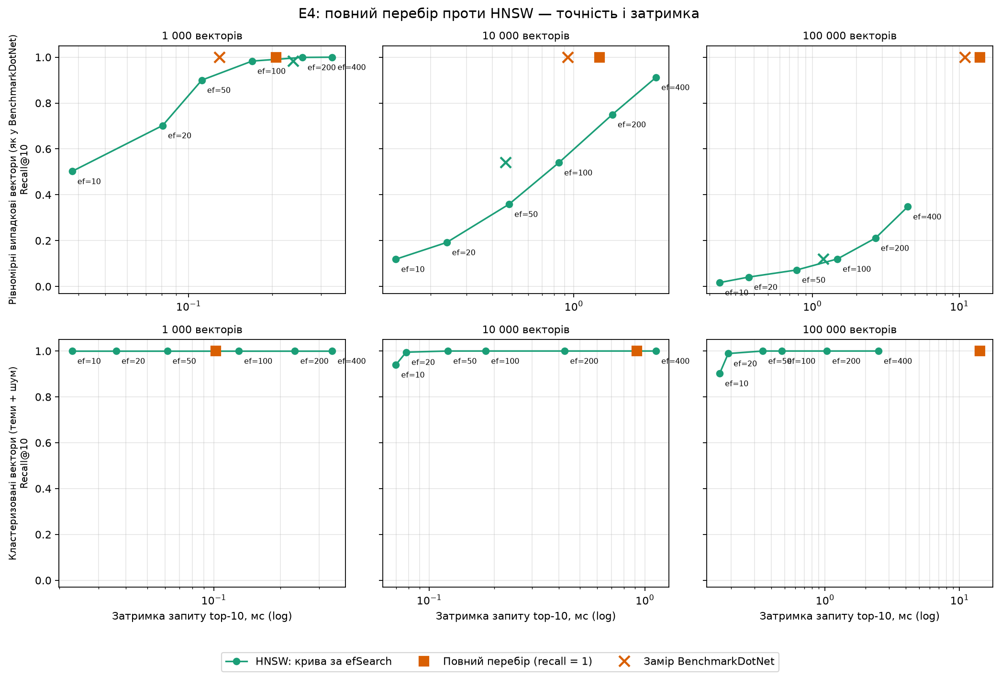
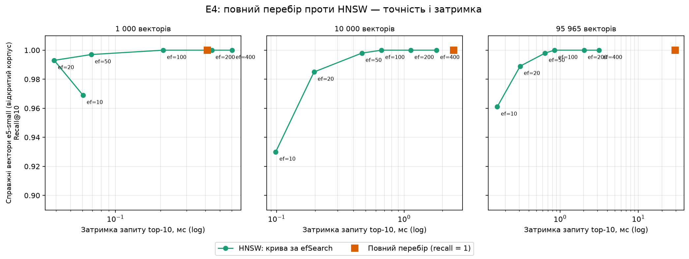

# E4 (R-06): повний перебір проти HNSW

Експеримент E4: на якій кількості векторів HNSW ([DR-023](../decisions.md)) вигідніший за повний перебір і якою
ціною для точності. Міряли recall@10 (частка точних десяти сусідів повного перебору, яку знайшов HNSW) і затримку одного запиту.

> **Це один прогін на одній машині.** Цифри показують порядок величин і форму залежності, а не точні значення:
> повторний запуск дасть інші затримки (на десятки відсотків) і ті самі висновки про recall.

## Залізо й умови

| | |
|---|---|
| Машина | ноутбук, AMD Ryzen 7 7735HS (16 потоків), 15 ГБ RAM, Windows 11 |
| Середовище | .NET 10.0.10, Release, BenchmarkDotNet 0.15.8 |
| Затримка BenchmarkDotNet | `SearchBenchmarks`, `--job short` (3 ітерації; через це похибка велика: на 1k вона більша за середнє) |
| Recall і крива за `efSearch` | `RecallReport` (`-- --recall`): медіана з 5 проходів по 100 запитах після розігріву |
| Індекс | HNSW із параметрами за замовчуванням: M = 16, efConstruction = 200, efSearch = 100 |
| Запитів | 100, top-10, 384 виміри (як у `multilingual-e5-small`), вектори нормовані |

Два набори даних:

- **uniform** — рівномірні випадкові вектори; ті самі, що в `SearchBenchmarks` (#158);
- **clustered** — спільний компонент, теми (`max(20, N/150)`) і шум; ближче до справжніх embeddings, така ж модель даних,
  як у `HnswIndexTests`. Це все одно синтетика, а не вектори реальних нотаток.

BenchmarkDotNet recall не міряє, тому `RecallReport` додає його окремо на тих самих даних. Крива за `efSearch` знімається на одному
побудованому графі: міняється лише ширина пошуку (через internal-перевантаження `HnswIndex.Search(query, k, efSearch)`, відкрите для
бенчмарків; граф для кожного значення заново не будується).

## Результати

HNSW із `efSearch = 100`. «BDN» — затримка за BenchmarkDotNet (є лише для uniform), «прогін» — затримка в прогоні recall.

| Дані | Векторів | Індекс | Recall@10 | Затримка (BDN) | Затримка (прогін) |
|---|---:|---|---:|---:|---:|
| uniform | 1 000 | BruteForce | 1,000 | 129 мкс | 206 мкс |
| uniform | 1 000 | HNSW | 0,983 | 239 мкс | 169 мкс |
| uniform | 10 000 | BruteForce | 1,000 | 937 мкс | 1,34 мс |
| uniform | 10 000 | HNSW | 0,540 | 464 мкс | 846 мкс |
| uniform | 100 000 | BruteForce | 1,000 | 10,95 мс | 13,81 мс |
| uniform | 100 000 | HNSW | 0,120 | 1,19 мс | 1,48 мс |
| clustered | 1 000 | BruteForce | 1,000 | — | 102 мкс |
| clustered | 1 000 | HNSW | 1,000 | — | 130 мкс |
| clustered | 10 000 | BruteForce | 1,000 | — | 916 мкс |
| clustered | 10 000 | HNSW | 1,000 | — | 183 мкс |
| clustered | 100 000 | BruteForce | 1,000 | — | 14,16 мс |
| clustered | 100 000 | HNSW | 1,000 | — | 478 мкс |

Як змінюється recall із `efSearch` (100 000 векторів; затримка — з прогону recall):

| efSearch | uniform: recall | uniform: затримка | clustered: recall | clustered: затримка |
|---:|---:|---:|---:|---:|
| 10 | 0,017 | 0,23 мс | 0,902 | 0,16 мс |
| 20 | 0,041 | 0,37 мс | 0,989 | 0,19 мс |
| 50 | 0,072 | 0,78 мс | 1,000 | 0,35 мс |
| 100 | 0,120 | 1,48 мс | 1,000 | 0,48 мс |
| 200 | 0,211 | 2,69 мс | 1,000 | 1,03 мс |
| 400 | 0,348 | 4,46 мс | 1,000 | 2,50 мс |

Час побудови HNSW (uniform / clustered) у цьому прогоні: 1k — менше секунди; 10k — 14 с / 7 с; 100k — 348 с / 165 с. Після прискорення з #179
окремий замір на тій самій машині дав: 10k — 10 с / 6 с; 100k — 234 с / 121 с (до того ж замірювання: 244 с / 144 с); розкид між прогонами сягає
10–40 %. Прискорення скромне, бо побудова впирається в звернення до пам'яті (деталі — [DR-023](../decisions.md)). Повний перебір будується миттєво.



## Висновки

1. **На рівномірному шумі HNSW із типовими параметрами майже не працює на великих обсягах.** Recall@10 падає з 0,98 (1k)
   до 0,54 (10k) і 0,12 (100k). Прискорення «в 9 разів на 100k» (1,19 мс проти 10,95 мс у BenchmarkDotNet) отримано на
   відповідях, більшість яких хибна. Щоб дістати recall ≈ 0,9 на 10k, треба `efSearch = 400`, і тоді HNSW (2,5 мс) повільніший
   за повний перебір (1,3 мс). Це відома слабкість графових індексів на рівномірних даних великої розмірності (відстані між
   точками майже однакові), а не доказ помилки в `HnswIndex`; але бенчмарк на таких даних не показує реальну вигоду.
2. **На кластеризованих даних картина інша:** recall ≥ 0,99 уже при `efSearch ≥ 20` на 100k і 1,000 при `efSearch ≥ 50`.
   При `efSearch = 100` HNSW швидший за повний перебір у ≈ 5 разів на 10k (183 мкс проти 916 мкс) і в ≈ 30 разів на 100k
   (478 мкс проти 14,2 мс). На 1k вигоди немає: повний перебір швидший (102 мкс проти 130 мкс).
3. **Орієнтир для переходу узгоджено з [DR-023](../decisions.md):** виграш HNSW гарантовано з ≈ 100k фрагментів, а на
   10k залежить від даних. На нашому кластеризованому наборі HNSW уже на 10k швидший у ≈ 5 разів, але набір «легкий»:
   у DR-023 на кластеризованих векторах 10k при `efSearch = 100` recall лише 0,87 (0,95 при 200), тобто на реальних даних
   доведеться брати більшу ширину пошуку, і виграш на 10k зникає. Тому на десятках тисяч фрагментів лишається BruteForce
   (≈ 1 мс на запит), а на 100k і більше `efSearch` підбирають за recall на власних даних. Значення за замовчуванням
   (`efSearch = 100`) для великих індексів і складних даних дає низький recall.
4. **Ціна HNSW:** повільніша побудова при старті (на 100k — 2–6 хв залежно від даних і запуску; див. DR-023) і більше
   пам'яті; для ноутбука з бібліотекою до десятків тисяч фрагментів це не виправдано.

## Реальні вектори (відкритий корпус, R-01)

Те саме на справжніх embeddings: 96 065 фрагментів [відкритого корпусу](../../eval/datasets/open/README.md) (6489 документів, 7 мов,
різні жанри), проіндексованих `multilingual-e5-small` (384 виміри, вектори нормовані). Вектори беруться з `Embeddings` бази
індексації; 100 випадкових фрагментів (seed 7) стають запитами й **виключаються з індексу**, решта — індекс: 1 000, 10 000 і
весь залишок, 95 965. Параметри HNSW ті самі (M = 16, efConstruction = 200). Прогін — `RecallReport.RunReal`, `-- --real <вектори.f32>`.

| Векторів | Індекс | Recall@10 | Затримка | Побудова HNSW |
|---:|---|---:|---:|---:|
| 1 000 | BruteForce | 1,000 | 412 мкс | — |
| 1 000 | HNSW (efSearch 100) | 1,000 | 209 мкс | 1,0 с |
| 10 000 | BruteForce | 1,000 | 2,44 мс | — |
| 10 000 | HNSW (efSearch 100) | 1,000 | 665 мкс | 10,5 с |
| 95 965 | BruteForce | 1,000 | 29,4 мс | — |
| 95 965 | HNSW (efSearch 100) | 1,000 | 850 мкс | 185 с |

Крива за `efSearch` (recall@10 / затримка, мкс):

| efSearch | 1 000 | 10 000 | 95 965 |
|---:|---|---|---|
| 10 | 0,969 / 61 | 0,930 / 98 | 0,961 / 158 |
| 20 | 0,993 / 39 | 0,985 / 196 | 0,989 / 310 |
| 50 | 0,997 / 69 | 0,998 / 466 | 0,998 / 644 |
| 100 | 1,000 / 209 | 1,000 / 665 | 1,000 / 850 |
| 200 | 1,000 / 442 | 1,000 / 1 129 | 1,000 / 2 030 |
| 400 | 1,000 / 604 | 1,000 / 1 794 | 1,000 / 3 156 |



**Висновки.**

1. **На справжніх векторах HNSW із типовими параметрами працює добре, на відміну від рівномірного шуму.** Recall@10 = 1,000
   при `efSearch = 100` на всіх трьох розмірах, ≥ 0,99 уже при `efSearch = 20` (на 10k — 0,985). Реальні embeddings мають
   структуру (теми, мови, жанри), на якій граф навігується, а на uniform — ні (recall 0,12 на 100k).
2. **Виграш у швидкості з `efSearch = 100`:** ≈ 35 разів на 96k (850 мкс проти 29,4 мс), ≈ 3,7 раза на 10k (665 мкс проти
   2,44 мс). Для 1k повний перебір не варто міняти: 412 мкс у цьому прогоні — це шум (раніше 100–200 мкс), а ширина пошуку
   100 для HNSW на 1k — це майже обхід усіх вузлів. Для `efSearch = 20` виграш на 96k ще більший (≈ 95 разів, 310 мкс) при recall 0,989.
3. **Це підтверджує поріг DR-023 «≈ 100k гарантовано, на 10k залежить від даних»:** на реальних даних HNSW вигідний уже
   на 10k, але виграш на 10k невеликий (кілька разів, мілісекунди), і на нього впливає ціна побудови: 10,5 с на 10k і ≈ 3 хв
   на 96k (проти 2–6 хв на синтетиці). Для бібліотеки до десятків тисяч фрагментів повний перебір (≈ 1–2 мс) лишається розумним.
4. **Значення `efSearch` за замовчуванням (100) на цих даних зайве високе:** 50 дає recall 0,998 вдвічі швидше. Але підбирати
   за синтетикою не можна (на uniform 100 замало), тому для реальної бібліотеки краще міряти recall на власних векторах.

**Застереження.**

- **Затримки завищені й шумні.** Під час прогону Core в тому ж ноутбуці ганяв E2/E3 (індексації), тому абсолютні мікросекунди
  не можна порівнювати з таблицями вище. Повний перебір і HNSW замірено в одному прогоні й на одному процесі, тож
  співвідношення між ними чесне, але на малих розмірах воно ненадійне (аномалія 412 мкс на 1k).
- **Запити — фрагменти того ж корпусу, а не пошукові запити.** Вони з того самого розподілу, що й індекс, і мають
  «близьких родичів» (сусідні фрагменти тієї ж статті й її мовні версії), що полегшує задачу HNSW. Справжні запити користувача (90 із
  `open-eval/queries.jsonl`) потребують ембедингів тією ж моделлю з префіксом `query: ` — в `Benchmarks` моделі немає, тож це
  окремий крок; висновок про recall на запитах «із чужого розподілу» (короткі фрази) може бути гіршим.
- Один прогін, один ноутбук, 100 запитів.

## Обмеження

- Один прогін, один ноутбук; затримки від запуску до запуску відрізняються на десятки відсотків (наприклад, повний
  перебір на 1k: 129 мкс за BenchmarkDotNet і 206 мкс у прогоні recall). Висновки спираються на порядок величин і на recall, який від шуму майже не залежить.
- Заміри BenchmarkDotNet — `ShortRun` (3 ітерації), похибка велика.
- «Кластеризовані» вектори — штучні, нетипово «легкі» для HNSW. Перш ніж міняти значення за замовчуванням,
  E4 треба повторити на ембедингах справжнього корпусу (зроблено частково, див. «Реальні вектори») (наприклад, великої папки нотаток або публічного набору документів).
- Перевірено лише top-10 і лише M = 16, efConstruction = 200; інші параметри не досліджували.
- 100 запитів: оцінка recall має похибку порядку кількох відсотків.

## Як повторити

З кореня репозиторію:

```
dotnet run -c Release --project benchmarks/LocalMind.Benchmarks -- --filter "*SearchBenchmarks*" --job short --artifacts <тека>
dotnet run -c Release --project benchmarks/LocalMind.Benchmarks -- --recall --out <тека>/e4-recall.csv
python eval/plots/plot_e4.py --bdn <тека>/results/LocalMind.Benchmarks.SearchBenchmarks-report.csv --recall <тека>/e4-recall.csv --out <тека>/plots
```

Справжні вектори: з бази індексації (`Embeddings.Vector`, 1536 байтів на вектор) у сирий файл float32, далі прогін:

```
python -c "import sqlite3;c=sqlite3.connect('file:open.db?mode=ro',uri=True);f=open('vectors.f32','wb');[f.write(b) for (b,) in c.execute('select Vector from Embeddings order by ChunkId')]"
dotnet run -c Release --project benchmarks/LocalMind.Benchmarks -- --real vectors.f32 --out <тека>/e4-real.csv
python eval/plots/plot_e4.py --bdn ... --recall ... --real <тека>/e4-real.csv --out <тека>/plots
```

Повний прогін триває близько 20 хвилин (побудова HNSW на 100k — 3–6 хвилин). Для графіка потрібен Python із `matplotlib`
(див. [eval/plots/README.md](../../eval/plots/README.md)). Приклад вхідних CSV і графіка — у `eval/plots/example/e4/`,
тести скрипта: `python -m unittest discover -s eval/plots -p "test_plot_e4.py"`.
