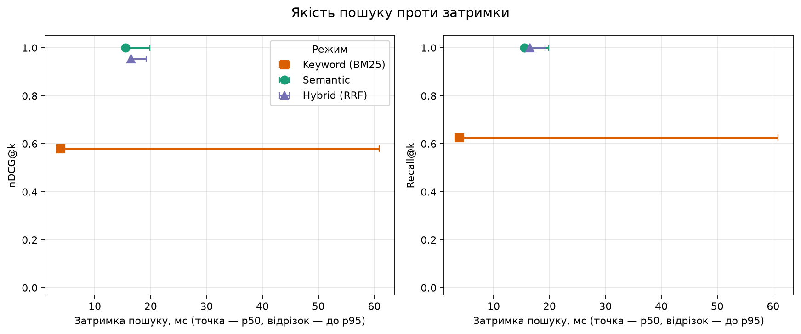

# Графіки для звіту (EV-06)

Скрипт `plot_eval.py` будує графіки з CSV команди `localmind eval` (`eval/results/*.csv`).
Для кожного датасету виходить по три графіки, у PNG (для презентації) і SVG (для звіту), підписи українською:

| Файл | Що показує |
|---|---|
| `quality_vs_latency` | nDCG@k і Recall@k проти затримки: точка — p50, відрізок — до p95; по точці на режим (і на прогін) |
| `by_query_type` | nDCG@k і Recall@k за типом запиту (`exact`, `paraphrase`, `crossLingual`) для кожного режиму |
| `recall_vs_latency` | Recall@k проти p50 для прогонів з різним `k`; будується, лише якщо в CSV є кілька різних `k` |



> **Графік E4 (R-06) ще не готовий.** E4 порівнює brute-force і HNSW на 1k / 10k / 100k фрагментів; його дані дасть
> BenchmarkDotNet з #158, а не CSV `localmind eval`. Графік «recall vs latency» для E4 з'явиться після #158.
> `recall_vs_latency` вище показує інше: Recall@k для різних глибин `k` на одному датасеті.

## Запуск

Потрібен Python 3.10+. Залежності з фіксованими версіями ставимо у віртуальне середовище, не глобально
(з кореня репозиторію):

```bash
python -m venv eval/plots/.venv
eval/plots/.venv/bin/pip install -r eval/plots/requirements.txt       # Windows: eval\plots\.venv\Scripts\pip
eval/plots/.venv/bin/python eval/plots/plot_eval.py eval/results      # Windows: eval\plots\.venv\Scripts\python
```

Аргумент — CSV-файли або теки з CSV; можна кілька. Графіки потрапляють у `eval/plots/out/` (змінюється `--out`).
Якщо в CSV кілька датасетів, кожен іде у свою підтеку. Згенеровані `out/` і `.venv/` у Git не потрапляють.

Перевірити на готовому прикладі (CSV демо-прогону лежить у репозиторії):

```bash
eval/plots/.venv/bin/python eval/plots/plot_eval.py eval/plots/example/demo.csv
```

Щоб побачити залежність від глибини `k`, запустіть `eval` з конфігом кількох прогонів (`--config`, див. `localmind eval --help`), де прогони відрізняються `k`,
і передайте скрипту отриманий CSV:

```json
{"runs": [{"name": "k1", "modes": ["keyword", "semantic", "hybrid"], "k": 1},
          {"name": "k3", "modes": ["keyword", "semantic", "hybrid"], "k": 3},
          {"name": "k10", "modes": ["keyword", "semantic", "hybrid"], "k": 10}]}
```

## Формат CSV, на який розраховує скрипт

Його пише `EvalReportWriter` (`src/LocalMind.Search/Evaluation/`). Один рядок — один прогін × режим × тип запитів;
розділювач — кома, десяткова крапка, перший рядок — заголовок.

| Колонка | Зміст |
|---|---|
| `dataset` | назва датасету |
| `run` | назва прогону (`cli` для одного прогону без `--config`) |
| `mode` | `keyword`, `semantic` або `hybrid` |
| `type` | `all` (усі запити) або тип запитів: `exact`, `paraphrase`, `crossLingual` |
| `queries` | кількість запитів |
| `k` | глибина метрик |
| `recall`, `mrr`, `ndcg` | Recall@k, MRR, nDCG@k, від 0 до 1 |
| `latency_p50_ms`, `latency_p95_ms` | медіана й 95-й перцентиль часу пошуку, мс |
| `documents`, `chunks`, `index_seconds`, `db_bytes`, `peak_memory_bytes` | про індексацію (скрипт їх не використовує) |

Обов'язкові для скрипта: `dataset`, `run`, `mode`, `type`, `queries`, `k`, `recall`, `mrr`, `ndcg`, `latency_p50_ms`,
`latency_p95_ms`. Якщо колонки немає чи значення не число, скрипт зупиняється з повідомленням «файл, рядок, причина» і кодом 1.
Для першого графіка беруться рядки `type = all`, для другого — рядки з типами запитів першого прогону.

## Тести

```bash
eval/plots/.venv/bin/python -m unittest discover -s eval/plots -p "test_*.py"
```

Приклад у `example/` оновлюйте лише разом зі зміною формату CSV: це єдині згенеровані файли, що лежать у Git.
